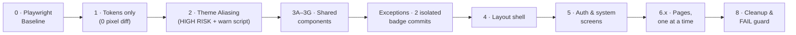

# IMS (`api-sims`) UI Alignment & Design Token Rollout Plan

> [!IMPORTANT]
> **Single Source of Truth:** This file (`docs/ui-plan.md`) is the **single source of truth** for the IMS (`api-sims`) UI design token specification, rollout stages, exceptions, verification rules, and design decisions.

## Goal

Adopt the shared Foundations design tokens and UI format from the Figma file **Bren Raphael's CRM + Orders Prototype** (`Foundations` page `#836:11278`, boards `00` through `08`) across the **IMS — Inventory Management System (`api-sims`)** frontend so that IMS is visually uniform with CREOMS and the sibling suite apps, **without changing any IMS logic, branding (`System="IMS"`), backend, API calls, or routes**.

---

# Part 1 — Extracted Figma Design Tokens & Usage Rules

## How to Use This Page (`00 · How to use this page` — `#838:2`)

> [!IMPORTANT]
> **Figma Foundations Rule:** The Figma Foundations page defines the shared design tokens for the suite UI (CREOMS, HRMS, **IMS**, and POS). Every screen, component, or code implementation must use these tokens. If something is not listed, reuse the closest existing pattern instead of inventing a new one.

### Core Rules for Designers and Agents
1. **No Hard-Coded Values:** Use only the text styles, color variables (`Foundations · Color`), and size variables (`Foundations · Size`) defined in the Foundations spec. Never hard-code a new hex, font size, or spacing value.
2. **Fonts:** Font is **Inter** everywhere. **Fraunces** is used only in the `"Bren Raphael's"` wordmark. **Montserrat** is used only inside the logo artwork. Do not use Bold (`700`) in the UI — Semi Bold (`600`) is the heaviest weight.
3. **Brand vs. AI Purple:** Primary purple `#5B2A86` (`brand/primary`) is for primary actions, active states, IDs, and links. `#7C3AED` (`brand/ai`) is reserved exclusively for AI features (sparkle icon, AI panels, confidence bars) so staff know to double-check AI output.
4. **Status Representation:** Status is always shown with a text-only pill (`Badge` component, `Status=…`), never with colored text alone. One status per record.
5. **Canvases & Shell:** Desktop canvas is `1440 × 900` with a fixed `288 px` sidebar and `64 px` top bar (content width `1088 px`, padding `20 top / 32 sides / 28 bottom`). Mobile canvas is `390 × 844` (never show the desktop sidebar on mobile — use the tab bar and back button).
6. **Auto Layout & Spacing:** Layout with auto layout. Spacing comes only from the 4-px-based scale: `4, 6, 8, 10, 12, 14, 16, 20, 24, 28, 32`. Padding inside a component is always `≥` the gap between its children.
7. **Corner Radii:** `6` small chips/checkboxes, `8` controls, `10` inner boxes/notices, `12` cards/tables, `16` modals/drawers/sheets, `999` pills. Don't nest more than two bordered containers (`page → card → inner box`).
8. **Writing & Formats:** Write in sentence case and plain words (verb-first on buttons, e.g., `"Approve replacement"`, never Title Case or vague `"OK"`/`"Submit"`). Money: `₱1,197` (`₱` + thousands comma, no decimals unless needed). Dates: `16 Oct 2026` or `16 Oct 2026, 2:15 PM` (relative time under 24h only).
9. **AI Behavior:** AI never acts on its own — it suggests, and staff `Accept` or `Change`. Every AI output shows: sparkle icon (`16 px`), `"AI"` wording, `confidence %`, a reason, and `Accept` / `Change` actions.
10. **Role Permissions:** Staff can do anything easy to undo; money, stock removal, AI-warning overrides, and moving others' work require a Manager → show `"Request approval"` (Secondary button + lock icon; never hide the action silently).

### Index of Foundations Boards
| Board | Node ID | What It Covers |
| :--- | :--- | :--- |
| **00 · How to use this page** | `#838:2` | Source-of-truth rules for designers/agents and board index |
| **01 · Typography** | `#838:101` | Every text style: titles, headings, paragraphs, labels, tables, nav, badges, buttons, mobile, brand |
| **02 · Color** | `#839:2` | Brand, AI, text, borders, backgrounds, status pills, semantic and notice colors, with usage |
| **03 · Spacing, radius & elevation** | `#839:391` | Spacing scale, corner radius, shadows, icon rules |
| **04 · Layout** | `#839:655` | Desktop shell, content grid, right rail, mobile shell, overlay sizes |
| **05 · Components** | `#840:2` | Buttons, inputs, badges, tabs, cards, stat tiles, notices, AI patterns, toasts |
| **06 · Tables** | `#844:41` | Table anatomy and spec |
| **07 · Brand** | `#844:955` | Logo lockups (`System=IMS`, `CREOMS`, `HRMS`, `POS`, `Enterprise Suite`) and app icon usage |
| **08 · Writing & formats** | `#844:1093` | Tone, capitalisation, money, dates, IDs, empty states |

---

## 1. Color Palette (`02 · Color` — `#839:2` & `07 · Brand` — `#844:955`)

### Brand & AI Colors
| Token (`Foundations · Color`) | Hex / Value | Usage |
| :--- | :--- | :--- |
| `brand/primary` | `#5B2A86` | Primary buttons, links, active tab text, record IDs, checkboxes |
| `brand/primary-hover` | `#4A226E` | Hover / pressed state of primary buttons |
| `brand/ai` | `#7C3AED` | AI only: sparkle icon, AI labels, confidence bars |
| `brand/focus` | `#A78BFA` | Focus ring (`2 px`) on inputs and buttons; Toast `"Undo"` action text |
| `brand/tint-soft` | `#F3E8FF` | Soft purple chip / icon tile background (`36 × 36` stat tile icon bg, AI button fill) |
| `brand/tint-tab` | `#EFE8F7` | Active tab / segmented control / active chip tab background |
| `brand/tint-selected` | `#F5F0FF` | Selected table row or option card background |
| `brand/border-selected` | `#8B5CF6` | Border of a selected card / radio option / active chip tab |
| `brand/ai-panel` | `#F7F3FB` | AI suggestion panel background |
| `brand/ai-panel-alt` | `#FBF8FF` | AI panel inside drawers |
| `brand/ai-border` | `#E9DDF7` | AI panel border and AI button stroke |

### Text Colors
| Token (`Foundations · Color`) | Hex / Value | Usage |
| :--- | :--- | :--- |
| `text/primary` | `#18181B` | Titles, body text, field values, active nav text |
| `text/strong` | `#3F3F46` | Table cells, sidebar nav items, form field labels |
| `text/secondary` | `#52525B` | Descriptions, secondary lines, icons, inactive underline tabs |
| `text/muted` | `#71717A` | Captions, timestamps, table column headers, placeholders, breadcrumbs |
| `text/disabled` | `#A1A1AA` | Disabled text and icons (only for disabled states; active text on white must be `text/muted` or darker `≥ 4.5:1`) |
| `text/on-brand` | `#FFFFFF` | Text on purple / dark backgrounds (primary/danger buttons, toasts) |

### Surfaces & Borders
| Token (`Foundations · Color`) | Hex / Value | Usage |
| :--- | :--- | :--- |
| `bg/page` | `#FAFAFA` | App background behind cards; table header row background; row hover |
| `bg/surface` | `#FFFFFF` | Cards, modals, drawers, sidebar, top bar, default inputs |
| `bg/subtle` | `#F1F1F3` | Neutral chips, segmented control track, skeletons, disabled inputs, empty-state icon circle |
| `bg/nav-active` | `#EFEFF1` | Active sidebar item background |
| `bg/switcher` | `#F4F1F7` | System switcher in the sidebar |
| `bg/toast` | `#18181B` | Toast background (with white `#FFFFFF` text) |
| `border/input` | `#E4E4E7` | Inputs, secondary buttons, chip tabs, dividers in forms |
| `border/card` | `#E6E1EE` | Cards, tables, modals outline (`1 px`) |
| `border/divider` | `#F0EDF4` | Horizontal dividers between rows inside tables, lists, and modal footers (`1 px`) |
| `border/topbar` | `#EBEBEB` | Top bar bottom border (`1 px`), sidebar right border (`1 px`) |

### Status Pills (`Badge` Component Background + Foreground Pairs)
| Pill Family | Background Token & Hex | Foreground Token & Hex | Use For |
| :--- | :--- | :--- | :--- |
| **Green** | `status/green-bg` (`#E3F4E8`) | `status/green-fg` (`#1E6B3A`) | Paid · Delivered · Resolved · Sent · Active · Completed · Accepted · In stock · Replaced |
| **Amber** | `status/amber-bg` (`#FDF1D8`) | `status/amber-fg` (`#8A5A00`) | Unpaid · For verification · Waiting · Requested · At risk · On hold · Low stock |
| **Red** | `status/red-bg` (`#FBE6E0`) | `status/red-fg` (`#9A3412`) | Cancelled · Open (ticket) · Failed · Rejected · High priority · Out of stock · Short |
| **Blue** | `status/blue-bg` (`#E3EEFB`) | `status/blue-fg` (`#1D4F91`) | Shipped · In transit · New · First order · Scheduled · Received · COD to collect · Ordered |
| **Teal** | `status/teal-bg` (`#E1F5EE`) | `status/teal-fg` (`#0F6E56`) | IMS-specific stock states (batch, ready for pickup) |
| **Purple** | `status/purple-bg` (`#EFE6F8`) | `status/purple-fg` (`#5B2A86`) | Confirmed · Packed · Approved · Repeat · In progress · Checked out |
| **Gray** | `status/gray-bg` (`#EEECF2`) | `status/gray-fg` (`#5A5368`) | Pending · Draft · Refunded · Closed · Lost · Normal · Not requested · COD compact badge |

### Semantic & Notice Colors
| Token (`Foundations · Color`) | Hex / Value | Usage |
| :--- | :--- | :--- |
| `semantic/success` | `#16A34A` | Success icons, positive stat deltas (`+12%`) |
| `semantic/warning` | `#B45309` | Warning icons, AI-warning text, warning stat deltas |
| `semantic/danger` | `#DC2626` | Destructive buttons (`Kind=Danger`), input error borders/messages, negative deltas |
| `notice/warning-bg` | `#FFFBEB` | Warning notice background, highlighted table row tint |
| `notice/warning-border` | `#F5DFA8` | Warning notice border (`1 px`) |
| `notice/warning-text` | `#78350F` | Warning notice text and icon |
| `notice/danger-bg` | `#FFF7F7` | Error / danger notice background |
| `notice/danger-border` | `#F4C7C7` | Error / danger notice border (`1 px`; paired with `#9A3412` danger notice text) |
| *Notice/info (from `05 · Components`)* | `#E3EEFB` bg/border, `#1D4F91` text | Info notice (uses `status/blue-bg` & `status/blue-fg`) |
| *Notice/success (from `05 · Components`)* | `#E3F4E8` bg/border, `#1E6B3A` text | Success notice (uses `status/green-bg` & `status/green-fg`) |

### Gradients, Scrims & Brand Lockup Tokens
| Token / Element | Value | Usage |
| :--- | :--- | :--- |
| `login/gradient-1` → `2` → `3` | `linear-gradient(90deg, #1F0F31 0%, #361A56 50%, #5B2A86 100%)` | Sign-in brand panel and full-screen loading screen (top-left → bottom-right) |
| Modal overlay scrim | `rgba(23, 15, 31, 0.45)` | Backdrop scrim behind modals and dialogs |
| `Logo/App icon` border | `#ECE6F2` | `1 px` border on light-surface app icon tile |
| `Logo/Lockup` (Light tone) | Wordmark `#2A0F3F`, Caption `#7A5899` | Used on white / light surfaces (IMS sidebar switcher, mobile drawer) |
| `Logo/Lockup` (Dark tone) | Wordmark `#FFFFFF`, Caption `#CDB8E6` | Used on dark login gradient |

---

## 2. Font Families (`00 · How to use this page` & `01 · Typography`)

| Font Family | Allowed Weights | Usage Rule |
| :--- | :--- | :--- |
| **Inter** | `400` (Regular), `500` (Medium), `600` (Semi Bold) | Primary UI font used everywhere across CREOMS, HRMS, IMS, and POS. **Never use Bold (`700`) in the UI.** |
| **Fraunces** | `600` (SemiBold) | Used **only** for the `"Bren Raphael's"` wordmark inside `Logo/Lockup` (`Brand/Wordmark`). |
| **Montserrat** | Artwork only | Used **only** inside the raster/vector logo artwork. Never use for UI text. |

---

## 3. Typography Scale: Font Sizes, Weights & Line Heights (`01 · Typography` — `#838:101`)

| Text Style Name | Font Family | Font Size | Line Height | Font Weight | Case & Tracking | Default Color Token | Use For |
| :--- | :--- | :--- | :--- | :--- | :--- | :--- | :--- |
| **Display/Page title** | Inter | `24 px` | `32 px` | `600` (Semi Bold) | Sentence, `0` | `text/primary` (`#18181B`) | One per screen, top of content (`H1`) |
| **Display/Stat value** | Inter | `24 px` | `32 px` | `600` (Semi Bold) | Sentence, `0` | `text/primary` (`#18181B`) | Big number in stat tiles |
| **Heading/Modal title** | Inter | `18 px` | `26 px` | `600` (Semi Bold) | Sentence, `0` | `text/primary` (`#18181B`) | Dialog and drawer titles |
| **Heading/Card title** | Inter | `16 px` | `24 px` | `600` (Semi Bold) | Sentence, `0` | `text/primary` (`#18181B`) | Card and section titles (`H2`) |
| **Heading/Subsection** | Inter | `14 px` | `20 px` | `600` (Semi Bold) | Sentence, `0` | `text/primary` (`#18181B`) | Groups inside a card (`H3`), notice headings |
| **Body/Default** | Inter | `14 px` | `20 px` | `400` (Regular) | Sentence, `0` | `text/primary` (`#18181B`) | Paragraphs and field values (max ~72 chars/line) |
| **Body/Strong** | Inter | `14 px` | `20 px` | `600` (Semi Bold) | Sentence, `0` | `text/primary` (`#18181B`) | Names and emphasis in body / primary table column |
| **Body/Secondary** | Inter | `13 px` | `18 px` | `400` (Regular) | Sentence, `0` | `text/secondary` (`#52525B`) | Descriptions, supporting text |
| **Body/Caption** | Inter | `12 px` | `16 px` | `400` (Regular) | Sentence, `0` | `text/muted` (`#71717A`) | Timestamps, helper text, footnotes, stat deltas |
| **Label/Field** | Inter | `13 px` | `18 px` | `500` (Medium) | Sentence, `0` | `text/strong` (`#3F3F46`) | Form labels, keys in key–value lists |
| **Label/Button** | Inter | `14 px` | `20 px` | `500` (Medium) | Sentence, `0` | Variant-dependent | Default buttons (`40 px` tall) |
| **Label/Button sm** | Inter | `13 px` | `18 px` | `500` (Medium) | Sentence, `0` | Variant-dependent | Small buttons (`32 px`), table actions, segmented/chip tabs |
| **Label/Tab** | Inter | `14 px` | `20 px` | `500` (Medium) | Sentence, `0` | `text/secondary` · active `brand/primary` | Underline tabs |
| **Label/Nav** | Inter | `14 px` | `20 px` | `500` (Medium) | Sentence, `0` | `text/strong` (`#3F3F46`) | Inactive sidebar items |
| **Label/Nav active** | Inter | `14 px` | `20 px` | `600` (Semi Bold) | Sentence, `0` | `text/primary` on `bg/nav-active` | Current active sidebar item |
| **Label/Nav group** | Inter | `11 px` | `16 px` | `600` (Semi Bold) | `UPPERCASE`, `+6%` (`0.06em`) | `text/muted` (`#71717A`) | Sidebar group labels |
| **Label/Breadcrumb** | Inter | `13 px` | `18 px` | `500` (Medium) | Sentence, `0` | `text/muted` · last `text/primary` | Breadcrumbs above page title |
| **Label/Badge** | Inter | `12 px` | `16 px` | `500` (Medium) | Sentence, `0` | `status/*-fg` | Status pills (foreground of its status) |
| **Label/Badge compact** | Inter | `11 px` | `14 px` | `500` (Medium) | Sentence, `0` | `status/*-fg` | Compact pills in dense tables |
| **Table/Header** | Inter | `12 px` | `16 px` | `500` (Medium) | Sentence, `0` | `text/muted` (`#71717A`) | Table column headers (never ALL CAPS) |
| **Table/Cell** | Inter | `13 px` | `18 px` | `400` (Regular) | Sentence, `0` | `text/strong` (`#3F3F46`) | Standard table cells (right-align money/quantities with tabular figures) |
| **Table/ID** | Inter | `13 px` | `18 px` | `600` (Semi Bold) | `UPPERCASE` ID, `0` | `brand/primary` (`#5B2A86`) | Clickable record IDs (`PO-2026-0151`, `HAL-SM-261012-A`, etc.) |
| **Mobile/App bar title** | Inter | `16 px` | `22 px` | `600` (Semi Bold) | Sentence, `0` | `text/primary` (`#18181B`) | Mobile header title |
| **Mobile/App bar subtitle** | Inter | `12 px` | `16 px` | `400` (Regular) | Sentence, `0` | `text/muted` (`#71717A`) | Mobile header subtitle |
| **Brand/Wordmark** | Fraunces | `20 px` | `24 px` | `600` (SemiBold) | Title, `0` | `text/primary` (`#2A0F3F` light / `#FFFFFF` dark) | `"Bren Raphael's"` wordmark in logo lockups only |
| **Brand/Caption** | Inter | `9 px` | `12 px` | `600` (Semi Bold) | `UPPERCASE`, `+12%` (`+1.1 px`) | `brand/primary` (`#7A5899` light / `#CDB8E6` dark) | Full system name under wordmark (`Inventory Management System`) |

---

## 4. Spacing Scale (`03 · Spacing, radius & elevation` — `#839:391`)

All spacing sits on a `4 px` base inside the `Foundations · Size` variable collection (`space/*`, `layout/*`):

| Token (`Foundations · Size`) | Value | Use For |
| :--- | :--- | :--- |
| `space/4` | `4 px` | Icon ↔ tiny text, pill dot gap, segmented control padding/gap |
| `space/6` | `6 px` | Pill icon gap, tight stacks, input helper text top gap, dropdown padding |
| `space/8` | `8 px` | Button icon gap, label ↔ input gap, list items gap, modal footer button gap |
| `space/10` | `10 px` | Table header vertical padding, inner box padding, sidebar switcher padding |
| `space/12` | `12 px` | Table row vertical padding, gap between fields in a row, input horizontal padding, sm button padding |
| `space/14` | `14 px` | Compact card padding, form field stack, notice horizontal padding |
| `space/16` | `16 px` | Card gap, grid gutter, table cell side padding, mobile page side padding, md button horizontal padding |
| `space/20` (`layout/page-top`) | `20 px` | Default card padding, desktop page top padding |
| `space/24` | `24 px` | Modal padding, drawer body padding, gap between page sections |
| `space/28` | `28 px` | Desktop page bottom padding |
| `space/32` (`layout/page-x`) | `32 px` | Desktop page side padding |

---

## 5. Border Radius (`03 · Spacing, radius & elevation` — `#839:391`)

| Token (`Foundations · Size`) | Value | Use For |
| :--- | :--- | :--- |
| *Checkbox (component-specific)* | `4 px` | `16 × 16 px` checkbox in forms and tables |
| `radius/sm` | `6 px` | Small chips, active segmented control item, skeleton blocks |
| `radius/control` | `8 px` | Buttons, inputs, selects, small icon tiles (`36 × 36`), sidebar nav items (`40 h`), segmented control container |
| `radius/inner` | `10 px` | Boxes inside cards, notices, thumbnails, dropdowns/popovers, toasts, `48 × 48` logo lockup tile |
| `radius/card` | `12 px` | Cards, tables, color swatches, sidebar system switcher, AI suggestion panel |
| `radius/modal` | `16 px` | Modals, drawers, mobile bottom sheets (top corners) |
| `radius/pill` | `999 px` | Status pills (`Badge`), chip tabs, avatars, toggles (`36 × 20`), empty-state icon circle (`64 × 64`) |

---

## 6. Shadows & Elevation (`03 · Spacing, radius & elevation` — `#839:391` & `05 · Components`)

Cards are **flat by default** (`1 px` `border/card` `#E6E1EE`, no shadow). Shadows are applied only to floating elements:

| Effect Style / Token | Box Shadow Value | Use For |
| :--- | :--- | :--- |
| `Elevation/Card` | `0px 1px 2px 0px rgba(24, 24, 27, 0.04)` | Optional subtle shadow paired with `1 px` `border/card` (`#E6E1EE`) |
| `Elevation/Modal` | `0px 12px 40px 0px rgba(0, 0, 0, 0.18)` | Modals, dialogs, popovers, dropdown menus |
| `Elevation/Drawer` | `-8px 0px 32px 0px rgba(0, 0, 0, 0.14)` | Right-side slide-over drawers (`480–540 px` wide) |
| *Input Focus Ring (`#840:124`)* | `0px 0px 0px 3px rgba(167, 139, 250, 0.35)` | Input focus halo (paired with `1.5 px` `brand/primary` `#5B2A86` border or `2 px` `brand/focus` `#A78BFA` ring) |

---

## 7. Iconography & Layout Reference (`03` & `04 · Layout`)

### Iconography Rules (Lucide Icons, Outline Style)
| Context | Size | Stroke Width | Color | Notes |
| :--- | :--- | :--- | :--- | :--- |
| **Buttons, inputs, table actions** | `16 px` | `2 px` | Inherit text color | `8 px` gap to label |
| **Sidebar nav** | `18 px` | `2 px` | `text/secondary` · active `text/primary` | `12 px` gap to label |
| **Card title / stat tile icon** | `20 px` in `36 px` tile | `2 px` | `brand/primary` on `brand/tint-soft` | Tile radius `8 px` |
| **Empty states** | `32 px` in `64 px` circle | `1.5 px` | `text/muted` on `bg/subtle` | Centered above title |
| **Mobile tab bar** | `22 px` | `2 px` | `text/muted` · active `brand/primary` | Label `11 px` below |
| **AI** | `16 px` sparkles | `2 px` (may be filled) | `brand/ai` (`#7C3AED`) | Always paired with `"AI"` or `confidence %` |

### Key Shell & Component Dimensions
| Element | Dimensions / Spec |
| :--- | :--- |
| **Desktop Canvas** | `1440 × 900 px` (`Sidebar` `288 px` fixed + `Top bar` `64 px` high + `Content` `1088 px` wide) |
| **Desktop Content Grid** | Padding `20 top / 32 sides / 28 bottom`; `Stats row` = 4 tiles with `16 px` gap; `Two-column detail` = `Main FILL` + `Right rail 320–400 px` (default `360 px`), gap `16 px` |
| **Mobile Canvas** | `390 × 844 px` (`Status bar` `44 px` + `App bar` `56 px` + `Body` `16 px` side padding & `16 px` card gap + `Sticky action bar` `76 px` with `48 px` tall full-width button + `Tab bar` `84 px`) |
| **Buttons (`Button`)** | `md`: `40 px` tall, `16 px` horizontal padding; `sm`: `32 px` tall, `12 px` horizontal padding; `mobile`: `48 px` tall; radius `8 px` |
| **Inputs (`Input`)** | `40 px` tall, `12 px` horizontal padding, radius `8 px`, label `8 px` above, helper/error `6 px` below; `Textarea` min `88 px` tall |
| **Badges (`Badge`)** | `22 px` tall, padding `3 px` vertical / `10 px` horizontal, radius `999 px`, text-only (no dot) |
| **Modals / Drawers / Toasts** | `Modal`: `480 px` (confirm), `560 px` (form), `640 px` (large), padding `24 px`, radius `16 px`; `Drawer`: `480–540 px` wide, right side; `Toast`: `360 px` wide, bottom-center (`24 px` from bottom), auto-hide `5 s` |

---

# Part 2 — Staged Rollout Plan for `api-sims` (Styling-Only, Zero Logic Changes)

### Hard Rules (Apply to Every Stage)

| ✅ Allowed | ❌ Not Allowed |
| :--- | :--- |
| CSS files (`app/styles/tokens.css`, `app/globals.css`) | Server actions (`app/actions/**`), API routes (`app/api/**`), `lib/**` |
| `className` strings, `cn(...)` / `cva(...)` class lists | Props, state, hooks, handlers, effects, conditionals |
| Inline `style={{...}}` **visual** values (colors, sizes) | Data fetching, API calls, route files' logic, `redirect`/`requireModule` calls |
| Style constants (e.g. `SIDEBAR_WIDTH`, chart color strings) | Adding, removing, or renaming components, routes, or exports |
| Tailwind/theme config & token-lint scripts (`scripts/check-tokens.mjs`) | Changing text content, IMS labels, or behavior (see **Exceptions** for the two isolated commits) |

> [!IMPORTANT]
> **One central place:** every token lives in **`app/styles/tokens.css`**. Components only use token-backed utilities (`bg-primary`, `type-card-title`, `rounded-card`, `shadow-modal`, `bg-scrim`). No raw hex values, no `text-[11px]`, and no raw Tailwind palette colors such as `text-emerald-600`.

---

## Stage Overview



| Stage | What | Files | Risk / Visible Change? |
| :--- | :--- | :---: | :--- |
| **0** | Playwright `toHaveScreenshot` baseline (`1440`, `768`, `375` widths) + checks | Test setup | **[COMPLETED]** No app change (84 snapshots recorded) |
| **1** | Central `tokens.css` (additive only) | 3 | **[COMPLETED]** None — passed Playwright `toHaveScreenshot` as pixel-identical |
| **2** | Point existing theme aliases at Figma values + `scripts/check-tokens.mjs` (WARNING mode) | 5 | **[COMPLETED]** Colors & 8px narrower sidebar applied cleanly |
| **3A–3G** | Shared components (buttons → tables) | ~33 | Yes, inside primitives (review Playwright diffs) |
| **Exceptions** | 1) Remove `PRStatusBadge` icons (JSX change)<br>2) Remap `StatusBadge` colors (UX change) | 2 (1 per commit) | **[COMPLETED]** Both isolated badge commits completed & verified |
| **4** | Layout shell (sidebar, header, page header, brand) | 11 | **[COMPLETED]** Yes (review Playwright diffs) |
| **5** | Auth and system screens | 8 | Yes (review Playwright diffs) |
| **6.1–6.10** | Pages, one module per sub-stage | ~140 | Yes, one module at a time (review Playwright diffs) |
| **7** | PDF and print exports | — | **Skipped for now** |
| **8** | Remove legacy tokens, switch `scripts/check-tokens.mjs` to **FAIL** mode | 3 | No visual change |

---

## Stage 0 — Automated Playwright Baseline

1. Create a branch, e.g. `style/figma-tokens`, with **one commit per stage** (and separate commits for the two **Exceptions**).
2. Record baseline results for `npm run typecheck`, `npm run lint`, `npm test`, and `npm run build`. Every stage must match these.
3. Set up **Playwright `toHaveScreenshot` visual regression tests** covering all routes in light and dark mode at three viewport widths:
   - **`1440 px`** (desktop canvas)
   - **`768 px`** (tablet breakpoint)
   - **`375 px`** (mobile viewport)
4. Generate and commit the baseline snapshot images before touching any CSS or components.
   - **Stage 1** must pass `npx playwright test` (`toHaveScreenshot`) with **zero pixel difference** against Stage 0.
   - **Stage 2 and later stages** intentionally change visuals; inspect the generated Playwright diff images at `1440`, `768`, and `375` widths to verify only the expected visual changes occurred before updating the baseline snapshots for the next stage.

---

## Stage 1 — Tokens only (nothing visibly changes)

Add every Figma token in one central file (`app/styles/tokens.css`). Existing variables (`--primary`, `--muted-foreground`, …) keep their current values in `:root`, so nothing changes on screen.

| File | Change |
| :--- | :--- |
| **[NEW]** `app/styles/tokens.css` | All Figma tokens (including `.dark` values for all new tokens): color primitives, semantic aliases, status pairs, notices, scrim, gradient, typography `@utility type-*`, radius, elevation, layout sizes, and pattern utilities |
| **[MODIFY]** `app/globals.css` | Add `@import "./styles/tokens.css";` after `@import "tailwindcss";`. No other edits yet |
| **[MODIFY]** `tailwind.config.ts` | Remove the duplicated `fontFamily` / `borderRadius` / `spacing` (Tailwind v4 ignores this file because there's no `@config`). Leave `content` plus a comment pointing to `tokens.css`, so the shadcn CLI still works |

### Token naming (what components will use)

| Figma token | CSS variable | Tailwind utility |
| :--- | :--- | :--- |
| `brand/primary` `#5B2A86` | `--color-primary` (existing alias) | `bg-primary`, `text-primary` |
| `brand/primary-hover` `#4A226E` | `--color-primary-hover` | `bg-primary-hover` |
| `brand/ai` `#7C3AED` | `--color-ai` | `text-ai` |
| `brand/focus` `#A78BFA` | `--color-focus` | `ring-focus` |
| `brand/tint-soft / tab / selected` | `--color-tint-soft`, `--color-tint-tab`, `--color-tint-selected` | `bg-tint-*` |
| `brand/border-selected` | `--color-border-selected` | `border-border-selected` |
| `brand/ai-panel / ai-panel-alt / ai-border` | `--color-ai-panel`, `--color-ai-panel-alt`, `--color-ai-border` | `bg-ai-panel`, `border-ai-border` |
| `text/primary … on-brand` | `--color-ink`, `--color-ink-strong`, `--color-ink-secondary`, `--color-ink-muted`, `--color-ink-disabled`, `--color-on-brand` | `text-ink`, `text-ink-strong`, … |
| `bg/page · surface · subtle · switcher · toast` | `--color-page`, `--color-surface`, `--color-subtle`, `--color-switcher`, `--color-toast` | `bg-page`, `bg-surface`, … |
| `border/input · card · divider · topbar` | `--color-input`, `--color-border`, `--color-divider`, `--color-topbar` | `border-input`, `border-border`, `border-divider`, `border-topbar` |
| `status/{green,amber,red,blue,teal,purple,gray}-{bg,fg}` | `--color-status-green-bg` … | `bg-status-green-bg text-status-green-fg` |
| `semantic/success · warning · danger` | `--color-success`, `--color-warning`, `--color-destructive` | `text-success`, … |
| `notice/warning-* · danger-*` | `--color-notice-warning-bg` … | `bg-notice-warning-bg` … |
| Modal scrim `rgba(23,15,31,.45)` | `--color-scrim` | `bg-scrim` |
| Radius 6/8/10/12/16/999 | `--radius-sm`, `--radius-control`, `--radius-inner`, `--radius-card`, `--radius-modal`, `--radius-pill` | `rounded-control`, `rounded-card`, … |
| `Elevation/Card · Modal · Drawer`, focus ring | `--shadow-card`, `--shadow-modal`, `--shadow-drawer`, `--shadow-focus` | `shadow-card`, `shadow-modal`, … |
| Layout 288 / 64 / 20·32·28 / 360 | `--layout-sidebar`, `--layout-topbar`, `--layout-page-*`, `--layout-rail` | used by `page-container` |
| 26 Figma text styles | `@utility type-*` | `type-page-title`, `type-card-title`, `type-body`, `type-caption`, `type-table-header`, `type-table-id`, … |

> [!NOTE]
> Typography uses a `type-` prefix (e.g. `type-card-title`) so it can't collide with color utilities like `text-card`. The spacing scale needs **no new tokens**, because Tailwind's default `--spacing: 0.25rem` already produces exactly 4, 6, 8, 10, 12, 14, 16, 20, 24, 28, 32 px (`1`, `1.5`, `2`, `2.5`, `3`, `3.5`, `4`, `5`, `6`, `7`, `8`).

### Sketch of `app/styles/tokens.css`

```css
/* Single source of truth — Figma "Foundations" (shared across IMS, CREOMS, HRMS, POS). */
:root {
  /* primitives */
  --brand-primary: #5b2a86;  --brand-primary-hover: #4a226e;  --brand-ai: #7c3aed;
  --brand-focus: #a78bfa;    --brand-tint-soft: #f3e8ff;      --brand-tint-tab: #efe8f7;
  --brand-tint-selected: #f5f0ff; --brand-border-selected: #8b5cf6;
  --brand-ai-panel: #f7f3fb; --brand-ai-panel-alt: #fbf8ff;   --brand-ai-border: #e9ddf7;
  --ink: #18181b; --ink-strong: #3f3f46; --ink-secondary: #52525b;
  --ink-muted: #71717a; --ink-disabled: #a1a1aa; --on-brand: #ffffff;
  --bg-page: #fafafa; --bg-surface: #ffffff; --bg-subtle: #f1f1f3;
  --bg-nav-active: #efeff1; --bg-switcher: #f4f1f7; --bg-toast: #18181b;
  --border-input: #e4e4e7; --border-card: #e6e1ee; --border-divider: #f0edf4; --border-topbar: #ebebeb;
  --status-green-bg: #e3f4e8;  --status-green-fg: #1e6b3a;
  --status-amber-bg: #fdf1d8;  --status-amber-fg: #8a5a00;
  --status-red-bg: #fbe6e0;    --status-red-fg: #9a3412;
  --status-blue-bg: #e3eefb;   --status-blue-fg: #1d4f91;
  --status-teal-bg: #e1f5ee;   --status-teal-fg: #0f6e56;
  --status-purple-bg: #efe6f8; --status-purple-fg: #5b2a86;
  --status-gray-bg: #eeecf2;   --status-gray-fg: #5a5368;
  --semantic-success: #16a34a; --semantic-warning: #b45309; --semantic-danger: #dc2626;
  --notice-warning-bg: #fffbeb; --notice-warning-border: #f5dfa8; --notice-warning-text: #78350f;
  --notice-danger-bg: #fff7f7;  --notice-danger-border: #f4c7c7;
  --scrim: rgb(23 15 31 / 0.45);
  --gradient-login: linear-gradient(90deg, #1f0f31 0%, #361a56 50%, #5b2a86 100%);
  --layout-sidebar: 288px; --layout-topbar: 64px; --layout-rail: 360px;
  --layout-page-top: 20px; --layout-page-x: 32px; --layout-page-bottom: 28px;
}
.dark {
  /* Dark mode values for all new tokens (since useSharedTheme in LayoutProvider can toggle .dark) */
}

@theme inline {
  --color-primary-hover: var(--brand-primary-hover);
  --color-ai: var(--brand-ai);
  --color-ink: var(--ink);
  --color-ink-muted: var(--ink-muted);
  --color-status-green-bg: var(--status-green-bg);
  --color-scrim: var(--scrim);
  /* …all other color mappings… */
  --radius-control: 8px; --radius-inner: 10px; --radius-card: 12px;
  --radius-modal: 16px;  --radius-pill: 999px;
  --shadow-card:   0 1px 2px 0 rgb(24 24 27 / 0.04);
  --shadow-modal:  0 12px 40px 0 rgb(0 0 0 / 0.18);
  --shadow-drawer: -8px 0 32px 0 rgb(0 0 0 / 0.14);
  --shadow-focus:  0 0 0 3px rgb(167 139 250 / 0.35);
  --shadow-sticky-col: 2px 0 5px -2px rgb(0 0 0 / 0.06); /* existing pattern, kept as a token */
  --font-brand: var(--font-fraunces), serif;
}

/* Typography (Figma 01 · Typography) */
@utility type-page-title   { font-size: 24px; line-height: 32px; font-weight: 600; }
@utility type-modal-title  { font-size: 18px; line-height: 26px; font-weight: 600; }
@utility type-card-title   { font-size: 16px; line-height: 24px; font-weight: 600; }
@utility type-subsection   { font-size: 14px; line-height: 20px; font-weight: 600; }
@utility type-body         { font-size: 14px; line-height: 20px; font-weight: 400; }
@utility type-body-strong  { font-size: 14px; line-height: 20px; font-weight: 600; }
@utility type-body-secondary { font-size: 13px; line-height: 18px; font-weight: 400; }
@utility type-caption      { font-size: 12px; line-height: 16px; font-weight: 400; }
@utility type-label-field  { font-size: 13px; line-height: 18px; font-weight: 500; }
@utility type-table-header { font-size: 12px; line-height: 16px; font-weight: 500; }
@utility type-table-cell   { font-size: 13px; line-height: 18px; font-weight: 400; }
@utility type-table-id     { font-size: 13px; line-height: 18px; font-weight: 600; }
@utility type-nav-group    { font-size: 11px; line-height: 16px; font-weight: 600;
                             text-transform: uppercase; letter-spacing: 0.06em; }
/* …plus stat-value, label-button(-sm), label-tab, label-nav(-active), breadcrumb,
   badge, badge-compact, mobile-title/subtitle, wordmark, brand-caption */

/* Repeated patterns (so pages swap class strings, not markup) */
@utility page-container { padding: var(--layout-page-top) var(--layout-page-x) var(--layout-page-bottom); }
@utility bg-login-gradient { background-image: var(--gradient-login); }
```

**Verify:** `npm run build` passes, and Playwright `toHaveScreenshot` tests (`1440`, `768`, `375` widths) pass as **pixel-identical**.

---

## Stage 2 — Point the existing theme at Figma values (HIGH RISK — first visible change)

> [!CAUTION]
> **HIGH RISK STAGE:** Re-pointing the existing `:root` and `.dark` aliases changes colors, borders, and radii across **~205 files at once** without touching those component files. This stage **must be isolated in its own commit** with a careful review of `git diff` and the Playwright visual diff images across all routes (`1440`, `768`, `375` widths) before proceeding.

Also introduce `scripts/check-tokens.mjs` in **WARNING mode** during this stage so every subsequent stage can track remaining hardcoded values as they shrink toward zero.

| File | Change |
| :--- | :--- |
| `app/globals.css` | Move the old `:root` / `.dark` values into `tokens.css` as aliases of the Figma primitives (below). Remove the duplicated hex values from `globals.css`. Keep the animations, scrollbar, and input-error rules |
| `app/styles/tokens.css` | `--foreground → --ink`, `--muted-foreground → --ink-muted`, `--secondary`/`--muted → --bg-subtle`, `--input → --border-input`, `--border-subtle → --border-divider`, `--destructive → --semantic-danger`, `--success`/`--warning → semantic`, `--badge-success/warning/destructive/info/teal/purple/neutral → status-* pairs`, `--radius-sm/md/lg → 6/8/10px` (was 6.4/8.4/10.4) |
| `components/ui/sidebar.tsx` | `SIDEBAR_WIDTH` / `SIDEBAR_WIDTH_MOBILE`: `"18.5rem"` → `"var(--layout-sidebar)"` (296 → 288 px) |
| **[NEW]** `scripts/check-tokens.mjs` | Scans `components/**`, `app/**` (excluding `actions`/`api`), and `dashboard/**` for raw hex codes, `text-[Npx]`, `font-bold/extrabold/black`, and raw Tailwind palette utilities (`text-emerald-600`, etc.). Runs in **WARNING mode** (prints summary and file/line matches, exits `0`) |
| `package.json` | Add `"lint:tokens": "node scripts/check-tokens.mjs --warn"` script |

**Visible effect:** slightly darker body text (`#1f1a2e → #18181b`), neutral grey muted text and subtle backgrounds (instead of purple-tinted), exact Figma badge colors, and a sidebar that's 8px narrower.

---

## Stage 3 — Shared components (sub-stages, one commit each)

Each sub-stage changes only class strings inside the listed files. Consumers pick up the changes automatically.

### 3A — Buttons (84 consumer files) — **[COMPLETED]**
| File | Change |
| :--- | :--- |
| `components/ui/button.tsx` | `default` size `h-9` → `h-10 px-4`, `sm` → `h-8 px-3`, `lg` → `h-12` (mobile 48), `rounded-md` → `rounded-control`, text → `type-label-button(-sm)`, remove `shadow-sm` (Figma is flat), primary hover → `bg-primary-hover`, secondary/outline → `bg-surface border-input text-ink`, ghost hover → `bg-subtle`, focus → `ring-2 ring-focus`, `disabled:opacity-40`. **Add** `ai` variant (`bg-tint-soft border-ai-border text-ai`), with no consumer changes |
| `components/auth/AuthScreen.tsx` | Align `primaryActionClass` / `secondaryActionClass` strings with the button tokens |

### 3B — Form controls (29 inputs, 23 selects, 15 textareas) — **[COMPLETED]**
| File | Change |
| :--- | :--- |
| `components/ui/input.tsx` | `h-10 px-3 rounded-control border-input bg-surface type-body`, placeholder `text-ink-muted`, focus `border-primary shadow-focus`, disabled `bg-subtle text-ink-disabled` |
| `components/ui/textarea.tsx` | Same as input, plus `min-h-[88px]` |
| `components/ui/select.tsx` | Trigger same as input; content `rounded-inner shadow-modal p-1.5`, items `h-9` |
| `components/ui/label.tsx` | `type-label-field text-ink-strong` |
| `components/ui/switch.tsx`, `components/ui/toggle.tsx` | Pill radius, `bg-primary` checked, 36×20 track |
| `components/ui/command.tsx` | Input and item tokens |
| `components/shared/SearchInput.tsx` (30 consumers) | Input tokens and 16px icon |
| `components/shared/AddressSelector.tsx` | Input and select tokens |

### 3C — Menus and popovers (19 dropdown consumers) — **[COMPLETED]**
`components/ui/dropdown-menu.tsx`, `components/ui/popover.tsx`, `components/ui/hover-card.tsx`, `components/ui/tooltip.tsx`: `rounded-inner`, `shadow-modal`, `p-1.5`, items `h-9 rounded-sm type-body`, separators `bg-divider`.

### 3D — Badges and status pills (styling only) — **[COMPLETED]**
| File | Change |
| :--- | :--- |
| `components/ui/badge.tsx` | `h-[22px] px-2.5 py-[3px] rounded-pill type-badge`. Add a `gray` variant. Point variants at `status-*` pairs. Remove the hover opacity (badges aren't interactive) |
| `components/inventory/write-off/SWOStatusBadge.tsx` | Class pass-through only |

*(Note: Removing icons from `PRStatusBadge.tsx` and remapping status colors in `StatusBadge.tsx` are handled in the **Exceptions** section below as their own separate commits.)*

### 3E — Cards, skeletons and empty state — **[COMPLETED]**
`components/ui/card.tsx` (`rounded-card border-border bg-surface`, **remove `shadow`**, `p-5`, `CardTitle → type-card-title`), `components/ui/skeleton.tsx` (`bg-subtle rounded-sm`), `components/ui/separator.tsx` (`bg-divider`), `components/ui/avatar.tsx`, `components/shared/EmptyState.tsx` (64px circle `bg-subtle`, 32px icon, `type-card-title`, `type-body-secondary`), `components/loading/page-loading.tsx`, `components/loading/audit-logs-skeleton.tsx`.

### 3F — Modals and overlays — **[COMPLETED]**
| File | Change |
| :--- | :--- |
| `components/ui/dialog.tsx`, `components/ui/alert-dialog.tsx` | Overlay `bg-black/80` → `bg-scrim`, content `rounded-modal shadow-modal p-6 bg-surface`, title `type-modal-title`, description `type-body text-ink-secondary`. **Keep the existing default max-width** here; set per-modal widths (`480` / `560` / `640 px`) in Stage 6 |
| `components/ui/sheet.tsx`, `components/ui/drawer.tsx` | `bg-scrim`, `shadow-drawer`, drawer width tokens (480–540) |
| `components/ui/sonner.tsx` | Toast `bg-toast text-on-brand rounded-inner`, 360 wide, action `text-focus` |
| `components/ConfirmModal.tsx`, `components/shared/ActionConfirmModal.tsx`, `components/resources-suppliers/ModalWrapper.tsx`, `components/receiving/NestedDialog.tsx` | Shared custom modal shells: `bg-black/60` → `bg-scrim`, radius, shadow, title, footer divider `border-divider` |

### 3G — Tables and pagination — **[COMPLETED]**
| File | Change |
| :--- | :--- |
| `components/ui/table.tsx` | Header row `bg-page`, `th` `px-4 py-2.5 type-table-header text-ink-muted`, row `border-t border-divider hover:bg-page data-[state=selected]:bg-tint-selected`, `td` `px-4 py-3 type-table-cell text-ink-strong` |
| `app/styles/tokens.css` | Add `@utility table-head-row`, `table-th`, `table-row`, `table-td`, `table-card` (same values) so the **hand-built** tables in Stage 6 can switch class strings without restructuring markup |
| `components/Pagination.tsx` (21 consumers), `components/pages/PaginationFooter.tsx` | Footer `px-4 py-3 border-t border-divider`, count `type-caption`, Secondary-sm buttons |

---

## Exceptions (Separate Commits)

> [!WARNING]
> Unlike pure CSS/class-string swaps, the two changes below either modify JSX children or alter the semantic color group a user sees for a given status. Each **must be committed on its own** with a clearly labeled commit message so it can be reviewed or reverted independently.

### Exception 1 — Remove Icons from `PRStatusBadge.tsx` (Changes JSX) — **[COMPLETED]**
* **Commit Label:** `refactor(ui-exception): remove icons from PRStatusBadge per Figma text-only badge spec`
* **File:** `components/orders-procurement/pr/PRStatusBadge.tsx`
* **Why It Is an Exception:** Figma (`05 · Components` `#840:151`) specifies that status badges are **text-only pills** (`no dot`, no icon). Removing `<FileEdit />`, `<Clock />`, `<RotateCcw />`, `<CheckCircle2 />`, `<XCircle />`, `<ArrowRightCircle />`, `<Ban />`, and `<Lock />` changes the rendered JSX children inside `PRStatusBadge`.

### Exception 2 — Remap Status Colors in `StatusBadge.tsx` (Changes User-Visible Status Colors) — **[COMPLETED]**
* **Commit Label:** `refactor(ui-exception): align StatusBadge status-to-color mapping with Figma spec`
* **File:** `components/shared/StatusBadge.tsx`
* **Why It Is an Exception:** Re-buckets statuses in `STATUS_GROUPS` to match the Figma `02 · Color` status table (e.g., `Draft` and `Closed` move from `purple` to `gray`; `Open` moves from `warning` to `destructive`/red; `Pending` moves to `gray`/`amber` per context; non-Figma `indigo`/`orange` buckets are mapped to standard Figma status colors). While status label strings remain unchanged, this changes the pill color users see for existing statuses.

---

## Stage 4 — Layout shell (sidebar, header, page containers) — **[COMPLETED]**

| File | Change |
| :--- | :--- |
| `components/shared/AppShell.tsx` | `<main>` → `bg-page` (Figma: app background behind cards) |
| `components/shared/Header.tsx` | `h-16` → `h-(--layout-topbar)`, `bg-surface border-topbar`, `px-6` |
| `components/shared/HeaderNotifications.tsx` | `text-[10px]` → `type-badge-compact`, legacy `text-body-sm`/`text-label-sm` → `type-*`, popover tokens |
| `components/shared/Sidebar.tsx` | Group label → `type-nav-group text-ink-muted`. Item `py-[9px] text-[15px]` → `h-10 px-2.5 rounded-control type-label-nav`, active → `type-label-nav-active bg-sidebar-accent text-ink`, icon `size-[18px]` → `size-4.5`. `pt-[18px]` → `pt-4.5` |
| `components/shared/SidebarEnterpriseHeader.tsx` | Switcher → `bg-switcher rounded-card p-2.5`, `gap-[11px]` → `gap-3`, `text-[11px] font-bold` → `type-nav-group`, menu tokens (keeping `BrandLockup system="IMS"`) |
| `components/shared/SidebarProfileFooter.tsx`, `components/shared/SidebarNavSkeleton.tsx` | Text, avatar and skeleton tokens |
| `components/brand/brand-lockup.tsx` | Hex values → brand lockup tokens (`--brand-lockup-*` in `tokens.css`), `font-[family-name:var(--font-fraunces)] text-[20px]` → `font-brand type-wordmark`, caption → `type-brand-caption`, `rounded-[12px]` → `rounded-inner` (Figma: 10) |
| `components/shared/PageHeader.tsx` | `text-2xl font-bold` → `type-page-title`, description → `type-body-secondary text-ink-secondary` |
| `app/layout.tsx` | Body classes `bg-page text-ink`. Fonts stay the same |
| `app/(root)/loading.tsx`, `app/(root)/error.tsx` | Container and text tokens |

**Page containers:** the `page-container` utility is added in Stage 1. Each page's wrapper (currently a mix of `py-6`/`py-7`/`py-8` and `px-4`/`px-6`/`px-8`) is switched to it in its own Stage 6 sub-stage.

---

## Stage 5 — Auth and system screens

`components/auth/AuthScreen.tsx` (card `rounded-modal`, title `type-page-title`), `components/auth/ContinueToPortal.tsx`, `components/auth/SignOutButton.tsx`, `app/no-access/page.tsx`, `app/sign-in-error/page.tsx`, `app/signing-in/page.tsx`, `app/unavailable/page.tsx`, `app/not-found.tsx` (legacy `text-display-sm`/`text-body-md` → `type-*`).

---

## Stage 6 — Pages, one at a time

Each sub-stage covers **one module** and is its own commit and review: its route files (`page`/`loading`/`error` classes only), its `View*` page, and its feature components. Apply the same **replacement cheat sheet** every time, set per-modal widths (`480` confirm / `560` form / `640` large) where applicable, and review the densest tables after applying the `12 px` minimum text size.

### Replacement cheat sheet

| Find (hardcoded) | Replace with (token) |
| :--- | :--- |
| Page wrapper `py-6/7/8 px-4 sm:px-6 md:px-8` | `page-container` |
| `text-[10px]`, `text-[11px]` (body, meta) | `type-caption` (12px; Figma: body never < 12px) |
| `text-[10px]/[11px]` on compact pills or group labels | `type-badge-compact` / `type-nav-group` |
| `font-bold`, `font-extrabold`, `font-black` | `font-semibold` or the matching `type-*` |
| Ad-hoc headings (`text-lg font-bold`, `text-base font-semibold`) | `type-card-title` / `type-subsection` / `type-modal-title` |
| `text-emerald-600 dark:text-emerald-400`, `text-green-600` | `text-success` |
| `text-amber-600 dark:text-amber-400` | `text-warning` |
| `text-red-500/600`, `text-rose-600` | `text-destructive` |
| `bg-amber-500/10 border-amber-500/30 text-amber-800…` (notice box) | `bg-notice-warning-bg border-notice-warning-border text-notice-warning-text rounded-inner` |
| `bg-red-50 border-red-200 text-red-700…` (error box) | `bg-notice-danger-bg border-notice-danger-border text-status-red-fg rounded-inner` |
| `bg-emerald-500/10 … text-emerald-800`, `bg-green-50 …` | `bg-status-green-bg text-status-green-fg` |
| `bg-blue-100`, `bg-yellow-50 border-yellow-200` | `bg-status-blue-bg` / notice-warning tokens |
| `bg-black/50…/80` overlays | `bg-scrim` |
| `shadow-[2px_0_5px_-2px_rgba(0,0,0,0.06)]` | `shadow-sticky-col` |
| `shadow`/`shadow-sm` on cards | removed (flat), or `shadow-card` |
| `rounded-lg` on cards / `rounded-xl` / `rounded-2xl` on modals | `rounded-card` / `rounded-modal` |
| Hand-built `<table>` header, row and cell class strings | `table-head-row`, `table-th`, `table-row`, `table-td` |
| `font-mono` on IDs, SKUs, and quantities | `type-table-id tabular-nums` (IDs) or `type-table-cell tabular-nums` (Inter) |
| Chart hex (`#16a34a`, `#2a2236`, `#f7f5fa`) | `var(--color-success)`, `var(--color-ink-strong)`, `var(--color-page)` |
| AI elements using `text-primary` / `text-purple-*` | `text-ai`, `bg-ai-panel`, `border-ai-border` |

### Sub-stages (in order: smallest first to prove the pattern)

| # | Module | Files touched |
| :--- | :--- | :--- |
| **6.1** | **Dashboard** | `dashboard/page.tsx`, `app/(root)/page.tsx`, `components/dashboard/kpi-cards.tsx`, `ai-recommendations.tsx`, `DashboardSkeleton.tsx`, `EmptyChart.tsx`, `distribution-analytics-chart.tsx`, `inventory-distribution-chart.tsx`, `procurement-trend-chart.tsx`, `production-quality-chart.tsx`, `supplier-performance-chart.tsx` *(11)* |
| **6.2** | **Inventory and write-off** | `app/(root)/inventory/{page,loading,error}.tsx`, `components/pages/ViewInventory.tsx`, `components/inventory/{InventorySkeleton,InventorySummaryCards,InventoryTable}.tsx`, `components/inventory/write-off/{CreateSWOModal,StockWriteOffTab,SWOActionModal,SWODetailsModal,SWOTable}.tsx`, `components/lots/LotsTable.tsx` *(13)* |
| **6.3** | **Resources and Suppliers** | `app/(root)/resources-suppliers/{page,loading,error}.tsx`, `components/pages/ViewSuppliers.tsx`, `components/resources-suppliers/{CategoryModal,CategoryTab,CategoryTable,RecipeIngredientItem,RecipeModal,RecipeSummaryCards,RecipeTab,RecipeTable,ResourcesSkeleton,ResourceStatusTabs,SupplierDetailsModal,SupplierModal,SupplierTab,SupplierTable,SupplyDetailsModal,SupplyModal,SupplySummaryCards,SupplyTab,SupplyTable}.tsx`, `components/SupplierTable.tsx`, `components/SupplyTable.tsx` *(25)* |
| **6.4a** | **Orders · Purchase requisitions** | `app/(root)/orders-procurement/{create-pr/page,edit-pr/[id]/page}.tsx`, `components/orders-procurement/pr/{CreatePRForm,PRActionModal,PRDetailsModal,PRTab,PRTable}.tsx` *(7)* |
| **6.4b** | **Orders · Purchase orders** | `components/orders-procurement/po/{CreatePOModal,POActionModal,POApprovalModal,PODetailsModal,POTab,POTable}.tsx` *(6)* |
| **6.4c** | **Orders · Deliveries and main view** | `app/(root)/orders-procurement/{page,loading,error}.tsx`, `components/pages/ViewOrdersProcurement.tsx`, `components/orders-procurement/{CreateOrderModal,OrderDetailsModal,OrdersSkeleton,ProcurementQAInspectionModal,ProcurementSummaryCards,ProcurementTable}.tsx`, `components/orders-procurement/delivery/{CancelDeliveryModal,CreateDeliveryModal,DeliveryDetailsModal,DeliveryTab,DeliveryTable,FileUploadField,MarkArrivedModal}.tsx` *(17)* |
| **6.5a** | **Receiving · GRN and pending** | `app/(root)/goods-receiving/{page,loading,error}.tsx`, `components/pages/ViewGoodsReceiving.tsx`, `components/receiving/{PendingReceivingTable,CreateGrnModal,GrnDetailsModal,GrnTab,GrnTable,DeliveryDetailsModal,ReceivingSkeleton}.tsx` *(11)* |
| **6.5b** | **Receiving · QA and discrepancies** | `components/receiving/{AddQaModal,QaInspectionModal,QaTab,QaTable,DiscrepancyDetailsModal,DiscrepancyTab,DiscrepancyTable}.tsx` *(7)* |
| **6.5c** | **Receiving · Stock-in, RTV, loss** | `components/receiving/{CreateStockInModal,StockInDetailsModal,StockInTab,RtvTab,LossReportTab}.tsx` *(5)* |
| **6.6a** | **Production · Requests, config, tracking** | `app/(root)/production-quality/{page,loading,error}.tsx`, `components/pages/ViewProduction.tsx`, `components/production/{ProductionRequestsTab,ProductionRequestModal,PrSummaryModal,ConfigurationTab,ProductionTrackingTab,ProductionKpiCards,ProductionSkeleton,AddFinishedProductModal}.tsx` *(12)* |
| **6.6b** | **Production · Batches** | `components/production/{ProductionBatchDetailsModal,ProductionBatchDetailView,BatchCompletionModal,BatchLifecycleSummaryModal,BatchProofField,ProductionActionModal,ProductionSummaryModal,ProductionImage,QrScannerModal}.tsx` *(9)* |
| **6.6c** | **Production · Issuance, stock-in, loss, QA** | `components/production/{MaterialIssuanceModal,MaterialIssuanceTab,ProductionStockInTab,LossTab,ProductionQaTab}.tsx` *(5)* |
| **6.7** | **Stock Transfer** | `app/(root)/stock-transfer/{page,loading,error}.tsx`, `components/stock-transfer/{StockTransferModule,StockTransferSummaryCards,TransferSkeleton,STRTable,STRDetailsModal,STRActionModal,CreateSTRModal,STFTable,STFDetailsModal,STFActionModal,DispatchTransferModal,ScheduleTransferModal,StockTransferConfirmModal,LocationsTab,TransferProofThumbnail}.tsx` *(18)* |
| **6.8** | **Distribution analytics** | `app/(root)/distribution-analytics/{page,loading,error}.tsx`, `app/(root)/distribution/loading.tsx`, `components/pages/ViewDistribution.tsx`, `components/CreateTransferModal.tsx`, `components/StockTransferTable.tsx`, `components/distribution/{CreateTransferModal,DistributionSummaryCards,LocationDetailsModal,LocationModal,LocationTable,StockTransferTable}.tsx` *(14)* |
| **6.9** | **MRP** | `app/(root)/mrp/{page,loading,error}.tsx`, `components/pages/ViewMrp.tsx` *(4)* |
| **6.10** | **Audit logs (all `/logs` routes)** | `app/(root)/{inventory,goods-receiving,orders-procurement,production-quality,resources-suppliers,stock-transfer}/logs/page.tsx`, `app/(root)/resources-suppliers/logs/loading.tsx`, `components/pages/{ViewTransactionalLogs,AuditLogsTable,AuditLogsFilterBar,AuditLogDetailsModal}.tsx` *(11)* |

> [!NOTE]
> **Excluded (unused, no importers found):** `components/BatchDetailsModal.tsx`, `CreateBatchModal.tsx`, `DarkModeToggle.tsx`, `DispatchModal.tsx`, `ErrorModal.tsx`, `LocationManager.tsx`, `QAChecklistModal.tsx`, `RecipeCard.tsx`, `UploadImagesModal.tsx`, `components/pages/ViewLots.tsx`, `ViewCycleCounts.tsx`, `ViewTraceability.tsx`, `ViewValuation.tsx`, `components/shared/under-construction.tsx`. These are left untouched. Deleting dead code is out of scope.

---

## Stage 7 — PDF and print exports (Skipped for now)

> [!NOTE]
> **Status: Skipped for now.** The 8 `download*Pdf.ts` jsPDF generators and `PurchaseOrderPrintDocument.tsx` are deferred and excluded from the current rollout.

---

## Stage 8 — Cleanup and FAIL guard

| File | Change |
| :--- | :--- |
| `app/globals.css` / `app/styles/tokens.css` | Remove legacy tokens once no references remain: `@utility text-display-* / headline-* / body-* / label-*`, `--badge-indigo/orange` (once unused), named spacing `--spacing-xs…3xl` (migrate the 31 files using `p-sm`/`gap-md` to numeric equivalents in their page stage) |
| `scripts/check-tokens.mjs` + `package.json` | Switch `scripts/check-tokens.mjs` (added in Stage 2 in WARNING mode) to **FAIL mode** (`node scripts/check-tokens.mjs` exits non-zero if `components/**`, `dashboard/**`, or `app/**` — excluding `actions`/`api` — contain raw hex, `text-[Npx]`, `font-bold/extrabold/black`, or raw Tailwind palette classes such as `text-emerald-600`) |

---

## Verification (Every Stage)

### Automated Checks & Diff Guardrails
```powershell
cd c:\Users\11\Desktop\R3B2P\api-sims
npm run typecheck; npm run lint; npm test; npm run build; npm run lint:tokens

# 1. REQUIRED: Always run git diff --stat and confirm ONLY the stage's listed files changed,
#    and confirm NOTHING under app/actions/, app/api/, or lib/ changed.
git diff --stat
git diff --name-only | Select-String '^(app/actions/|app/api/|lib/)'

# 2. Rough diff filter: surface changed lines that do not match obvious class/style patterns.
#    NOTE: This regex command is ONLY a rough filter — always review the full git diff manually.
git diff -U0 -- '*.tsx' '*.ts' | Select-String '^[+-](?![+-])' | Select-String -NotMatch 'className|cn\(|cva\(|class=|style=|variant:|size:|^\s*[+-]\s*"[^"]*",?\s*$'
```

> [!WARNING]
> **Mandatory Path & Diff Check:**
> 1. Always run `git diff --stat` at every stage and verify that **zero files** under `app/actions/`, `app/api/`, or `lib/` were touched (note: `lib/pdf-theme.ts` would only apply if Stage 7 were enabled later; since Stage 7 is skipped, nothing in `lib/` may change).
> 2. The `Select-String` diff-audit command above is **only a rough filter** — it can miss logic edits on lines that also contain `className` or flag multi-line class strings. Always inspect the full `git diff` manually before committing.

### Visual Regression & Interactive Review
- **Playwright `toHaveScreenshot` (`1440`, `768`, `375` widths):**
  - **Stage 1:** Must pass `npx playwright test` with **zero pixel diff** against the Stage 0 baseline.
  - **Stage 2–Stage 6:** Inspect the Playwright diff images across all three widths (`1440`, `768`, `375`) in both light and dark mode to verify that only expected token changes occurred.
- **Interactive States:** Verify hover, focus ring (purple halo), disabled (`40%`), selected table row, open modal/drawer/toast, and empty state.

---

## Final Design & Rollout Decisions

1. **Dark Mode:** **Include `.dark` values for all new tokens.** (`providers/LayoutProvider.tsx` calls `useSharedTheme()` from `@r3b2p/uilib`, which toggles `.dark` on `document.documentElement` via `?theme=dark`, `localStorage.getItem("theme")`, or `BroadcastChannel("theme-sync")`).
2. **Monospace IDs/SKUs (`font-mono` in 34 files):** **Use Inter + `tabular-nums`** (`type-table-id tabular-nums` for IDs and `type-table-cell tabular-nums` for quantities/codes).
3. **Status Colors (`StatusBadge.tsx`):** **Follow the Figma status-to-color mapping**, committed in **its own separate commit** (see **Exception 2**).
4. **Badge Icons (`PRStatusBadge.tsx`):** **Remove icons** so badges are text-only pills per Figma, committed in **its own separate commit** (see **Exception 1**).
5. **Dialog Widths:** **Keep the existing default widths in Stage 3F**, and set Figma widths (`480 px` confirm / `560 px` form / `640 px` large) per modal during Stage 6.
6. **Minimum Text Size (`12 px`):** **Accept the `12 px` minimum (`type-caption`)** across `text-[10px]` / `text-[11px]` usages, then review the densest tables during Stage 6.
7. **PDFs (Stage 7):** **Skip for now.**
